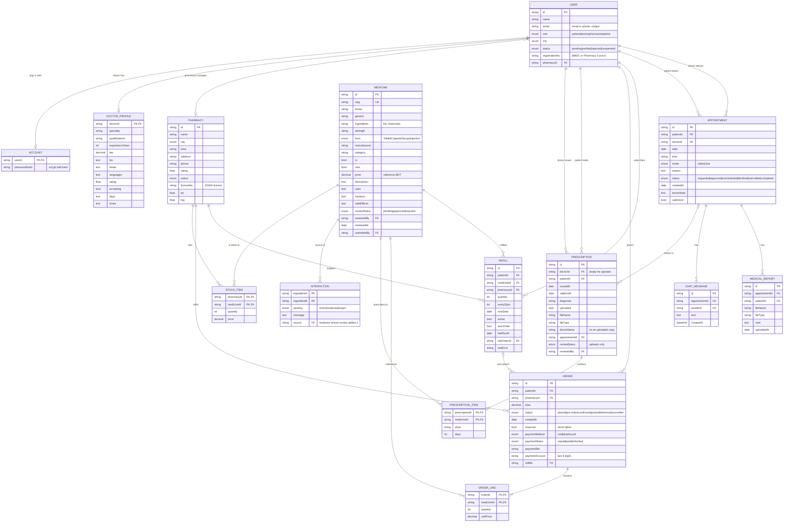

# ER Diagram and Data Dictionary — MediReach

The prototype stores each entity as a collection in `.data/db.json` (types in `src/lib/types.ts`). The diagram is drawn as the relational schema a MySQL deployment would use: embedded objects (medicine review, prescription review, payment) become columns, and arrays (prescription items, order lines) become child tables.

## Data dictionary notes

| Entity | Notes |
|---|---|
| USER | One table for all roles. `status` drives access: doctors and pharmacists start `pending`. |
| ACCOUNT | Kept apart from USER so password hashes are never sent with user data. |
| MEDICINE | `ingredients` drive duplicate detection. A row without a review state is approved (starter catalogue). Only approved rows are "live". |
| STOCK_ITEM | One row per pharmacy and medicine. The pharmacy's own price overrides the reference price. |
| INTERACTION | Pair of ingredient names, stored in either order and matched both ways. Curated; doctors add pairs when reviewing a medicine. |
| PRESCRIPTION | Valid 30 days from issue. Uploaded copies (`uploaded = true`) also need `reviewStatus = approved`. The file is stored at `.data/uploads/<id>`. |
| ORDER | One per pharmacy per checkout. Payment columns are simulated; full card or wallet numbers are never stored. |
| REFILL | `autoOrder` off by default. `lastRunAt` limits automatic attempts to one a day. |
| MEDICAL_REPORT | The file is stored at `.data/uploads/<id>`. |

Rare medicines (`MEDICINE.rare`) and nearby search (`PHARMACY.lat/lng`) together support the core objective: finding hard-to-find medicines across the country.
