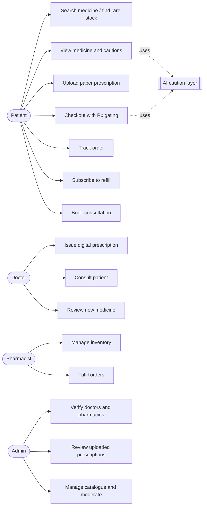

# Use Cases and Wireframes — MediReach

Requirement IDs (FR-…) refer to [SRS.md](SRS.md).

## 1. Use case overview



## 2. Use cases

### UC1 — Search medicine and find rare stock (FR-C1, FR-C3)

- **Actor:** any visitor.
- **Main flow:** 1. Enter a brand, generic or disease, optionally "Rare only". 2. Open a result. 3. Choose a city, or press "Near me" and allow location. 4. See pharmacies within 10 km (or in the city) first, then the rest of Bangladesh, with price and stock.
- **Alternative:** no pharmacy nearby → the list says so and shows further pharmacies.

### UC2 — View medicine and cautions (FR-C2, FR-AI1–AI4)

- **Actor:** any visitor; patient for profile checks.
- **Main flow:** 1. Open a medicine page. 2. The caution panel shows uses and cautions. 3. For a signed-in patient it also warns when the medicine clashes with one on their profile. 4. With phrasing on, a short plain-language summary appears above. 5. The disclaimer closes the panel.

### UC3 — Upload a paper prescription (FR-R2, FR-R3)

- **Actor:** patient. **Pre:** signed in.
- **Main flow:** 1. Open Prescriptions → Upload. 2. Enter doctor name, date, medicines and attach a photo/PDF. 3. The copy is saved as "pending". 4. An admin approves it (UC14). 5. Its Rx medicines can now be ordered.
- **Exceptions:** wrong file type, file over 3 MB, or content not matching the type → error, nothing saved.

### UC4 — Checkout with Rx gating (FR-O1–O6, FR-R4)

- **Actor:** patient.
- **Main flow:** 1. Add medicines from one or more pharmacies. 2. Review the caution panel. 3. Choose cash on delivery, bKash or card. 4. Place order. 5. One order per pharmacy is created; items short of stock become a pre-order.
- **Exceptions:** Rx item without valid prescription → blocked with the brand names; invalid or declined payment → error, no stock taken; suspended account → refused.

### UC5 — Track order (FR-O3, FR-O4, FR-O7)

- **Actor:** patient. Steps Placed → Confirmed → Packed → Delivered with payment state. Cancel while not yet confirmed; a prepaid order is refunded.

### UC6 — Subscribe to a refill (FR-F1–F4)

- **Actor:** patient. 1. Choose medicine, pharmacy, packs, interval. 2. Optional: switch on auto-order. 3. On the due date the order is placed (auto) or the dashboard reminds the patient. 4. If auto-order fails (e.g. prescription expired), the reason is shown and it is retried next day.

### UC7 / UC9 — Book and hold a consultation (FR-V1–V5)

- **Actors:** patient, doctor. 1. Patient describes symptoms; the finder suggests specialties and doctors. 2. Patient books a slot. 3. Doctor approves, reschedules or declines. 4. Both chat (or run the demo call); the patient attaches test reports. 5. Doctor issues a prescription from the consultation.

### UC8 — Issue a digital prescription (FR-R1)

- **Actor:** verified doctor. 1. Choose patient (or open from a consultation). 2. Enter diagnosis and items (medicine, dose, days). 3. Save; valid 30 days. The patient can now order those Rx medicines.

### UC10 — Review a new medicine (FR-C4, FR-C5)

- **Actor:** verified doctor. 1. Open Medicine review. 2. Write description, uses, cautions, side effects, interactions. 3. Approve (goes live) or reject with a reason.

### UC11 / UC12 — Inventory and fulfilment (FR-P1, FR-O3)

- **Actor:** pharmacist. Set quantity and price per medicine. Move each order one step at a time; on delivery, cash is marked collected. Open a customer's uploaded prescription when checking an Rx order.

### UC13–UC15 — Administration (FR-M1–M5)

- **Actor:** admin. Verify or suspend doctors, pharmacists and pharmacies; approve or reject uploaded prescriptions; add and edit medicines; cancel problem orders; view statistics and API docs.

## 3. Wireframes

Low-fidelity layouts of the main screens. Labels and numbers are illustrative; on a phone the columns stack.

### Medicine page (`/medicines/[slug]`)

```
┌──────────────────────────────────────────────────────────────────────┐
│ Logo   Medicines  Pharmacies  How it works        [Cart 2] [Log in]  │
├──────────────────────────────────────────┬───────────────────────────┤
│ [Rx] [Rare] [Anticoagulant]              │ ✦ AI caution layer        │
│ Warf 5 mg                                │ ┌───────────────────────┐ │
│ Warfarin · Tablet · Maker · ref ৳18      │ │ plain summary (opt.)  │ │
│ Description …                            │ └───────────────────────┘ │
│ ⚠ Prescription-only …                    │ ! major interaction: Warf │
│ ┌ Where to buy ───────────────────────┐  │   + Ecosprin (profile)    │
│ │ [◎ Near me] (Dhaka)(Ctg)(Sylhet)…   │  │ Uses / cautions …         │
│ │ Within 10 km                         │  │ This is general info…    │
│ │  Gulshan Pharma  2.1 km  ৳18 [Add]   │  ├───────────────────────────┤
│ │ Further away                         │  │ Possible side effects     │
│ │  Port City …   245 km   ৳19 [Add]    │  │  • …                      │
│ └──────────────────────────────────────┘  │                           │
│ Same ingredient: (Brand A) (Brand B)     │                           │
└──────────────────────────────────────────┴───────────────────────────┘
```

### Cart and checkout (`/cart`)

```
┌──────────────────────────────────────────┬───────────────────────────┐
│ Items                                    │ Summary                   │
│  Napa 500 · Gulshan  [-] 2 [+]  ৳24  🗑   │ Total            ৳42      │
│  Warf 5   · Gulshan  [-] 1 [+]  ৳18  🗑   │ Ordering as Rahim         │
│   [Rx] ⚠ No valid prescription           │ ⚠ Rx items need a valid   │
├──────────────────────────────────────────┤   prescription: Warf      │
│ ✦ AI caution layer                       │ Payment                   │
│  ! Duplicate ingredient: Napa and Ace    │ [Cash] [bKash] [Card]     │
│    (on your profile)                     │ [ card number ][MM/YY]    │
│  Also checked against your profile: …    │ Simulated payment …       │
│  This is general information …           │ [ Pay ৳42 and place order]│
└──────────────────────────────────────────┴───────────────────────────┘
```

### Patient dashboard (`/patient`)

```
┌────────────┬─────────────────────────────────────────────────────────┐
│ Overview   │ Welcome, Rahim                                          │
│ Prescript. │ [Valid Rx 2] [Open orders 1] [Active refills 1] [Appts] │
│ Orders     │ ⟳ Refill due soon: Glucomin   [Manage refills]          │
│ Refills    │ Recent orders                                           │
│ Doctors    │  ORD-12  Gulshan  Napa ×2  ৳24  [paid/Card] [Packed]    │
│ Appoint.   │                                                         │
└────────────┴─────────────────────────────────────────────────────────┘
```

### Pharmacist orders (`/pharmacist/orders`)

```
┌──────────────────────────────────────────────────────────────────────┐
│ Order   Patient   Items         Total  Payment        Status  Actions │
│ ORD-12  Rahim     Napa ×2       ৳24    unpaid/Cash    Placed  [Confirm] [Cancel] │
│ ORD-13  Karim     Warf ×1 📎Rx  ৳18    paid/bKash     Packed  [Delivered]        │
└──────────────────────────────────────────────────────────────────────┘
```

### Admin verifications (`/admin/verifications`)

```
┌──────────────────────────────────────────────────────────────────────┐
│ Doctors  | Pharmacists | Pharmacies | Uploaded prescriptions          │
│ Imran Hossain  BMDC-A-51377  Chattogram  pending  [Verify] [Reject]   │
│ Salma Begum    BMDC-A-60214  Rajshahi    pending  [Verify] [Reject]   │
└──────────────────────────────────────────────────────────────────────┘
```
